# Cestovní příkazy

Webová aplikace pro zaměstnance: vyplní pracovní cestu, nechá si spočítat stravné a další cestovní náhrady podle českého zákoníku práce a připraví kompletní podklady pro účetní – cestovní příkaz k podpisu, vyúčtování se všemi doklady v jednom PDF a tabulky XLSX/CSV.

**Vyzkoušet:** <https://cestovni-prikazy.novot-michal.workers.dev> · bez registrace, data zůstávají jen ve vašem prohlížeči.

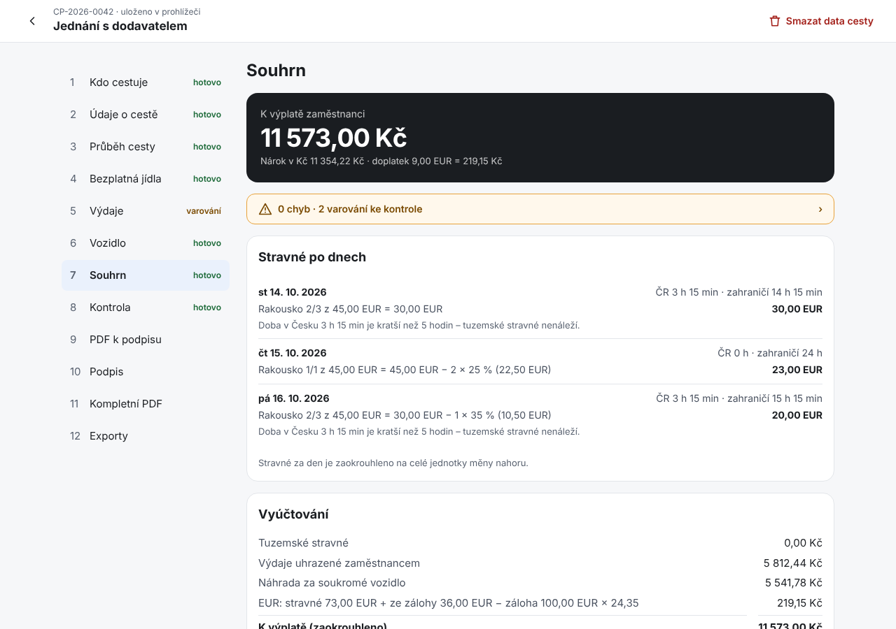

## Co aplikace umí

- **Průvodce v 10 krocích** – od zaměstnance a plánu cesty přes průběh, jídla, výdaje a vozidlo, souhrn s kontrolou až po PDF, podpis, kompletní dokumentaci a exporty. U každého kroku je vidět, co je hotové a kde je chyba nebo varování.
- **Tuzemské i zahraniční cesty** – stravné po dnech podle doby v Česku a v zahraničí, krácení za bezplatně poskytnutá jídla, kapesné, sazby podle vnitřního předpisu, podnikatelská i platová sféra.
- **Více států na jedné cestě** – v jednom úseku může být víc přechodů hranic (např. Ústí → Rakousko → Slovinsko → Záhřeb). Aplikace pozná, když po zemi „přeskočíte“ stát, se kterým výchozí stát nesousedí. Rozhodující stát dne je ten, kde jste strávili nejvíc času.
- **Plán a průběh** – plán (cestovní příkaz schválený předem) s trasou, zastávkami a dopravními prostředky jde jedním kliknutím převzít do skutečného průběhu, včetně zpáteční cesty.
- **Výdaje ve více měnách** – kurz ČNB ke dni výdaje jedním tlačítkem, skutečně stržená částka podle potvrzení banky, kurz zálohy u výdajů placených ze zálohy, vyrovnání zálohy v cizí měně.
- **Doklady** – focení mobilem, PDF, JPG, PNG i HEIC. Otočení a ořez, kontrola skutečného formátu souboru, upozornění na duplicitní doklad. Originál se nikdy nemění.
- **Soukromé vozidlo** – základní náhrada za km a náhrada za palivo. Cena paliva podle dokladů o tankování (vážený průměr z více tankování), z jednoho dokladu, nebo průměrná cena z vyhlášky (zobrazená v aplikaci; po změně vyhlášky jde zadat ručně se zdrojem). Přiložení technického průkazu.
- **PDF k podpisu česky nebo anglicky** (pro zahraničního nadřízeného). Podpis jako nahraný sken, nebo vložený obrázek podpisu s razítkem. Číslo účtu pro výplatu je ve vyúčtování a při výdajích ze soukromých prostředků je povinné.
- **Kompletní dokumentace** – jedno PDF s krycím listem, obsahem, podepsaným dokumentem, přehledem výdajů a všemi doklady seřazenými podle výdajů, s čísly stran a záložkami. Jde zvolit, které části obsahuje (např. jen podepsaný dokument a doklady k výdajům).
- **Ověřitelný výpočet** – Souhrn ukazuje u každé částky postup s čísly cesty: časové úseky dne po státech, rozhodující stát, pásmo, krácení za jídla, přepočet kurzem, výdaje, vozidlo a zaokrouhlení výplaty. Odkazuje na stránku se všemi uloženými sazbami (stravné, 227 států, náhrada za km, ceny paliv). XLSX obsahuje celý výpočet jako vzorce Excelu se sloupcem „Kontrola“ proti výsledku aplikace.
- **Exporty** – XLSX a CSV pro účetní, JSON s úplnými daty, ZIP s originály dokladů a pracovní projekt (ZIP), který jde načíst v jiném prohlížeči nebo zařízení.
- **Zaměstnavatel z ARES** – vyhledání firmy podle IČO nebo názvu doplní název, IČO a sídlo. U státu, obce, kraje nebo příspěvkové organizace nastaví platovou sféru.
- **Hlídá formality** – dotaz na snídani v ceně ubytování, upozornění na doklad bez potvrzení o zaplacení, lhůta 10 pracovních dnů pro předložení vyúčtování, číslo účtu pro výplatu ve vyúčtování.
- **Na telefonu jako aplikace** – jde přidat na plochu a po první návštěvě funguje i bez připojení.
- **Sazby 2026** – tuzemské stravné, náhrada za km a ceny paliv podle vyhlášky 573/2025 Sb. a jejích novel, zahraniční stravné pro 227 států a území podle vyhlášky 489/2025 Sb. Odkazy na předpisy jsou přímo v aplikaci.

## Jak to vypadá

| | |
|---|---|
| 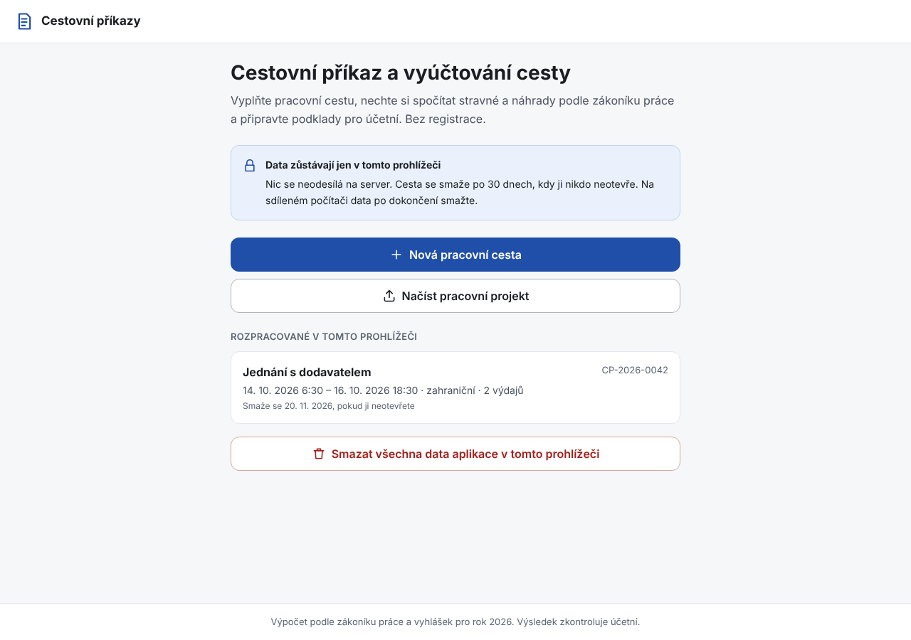 Úvod – rozpracované cesty v prohlížeči, načtení projektu | 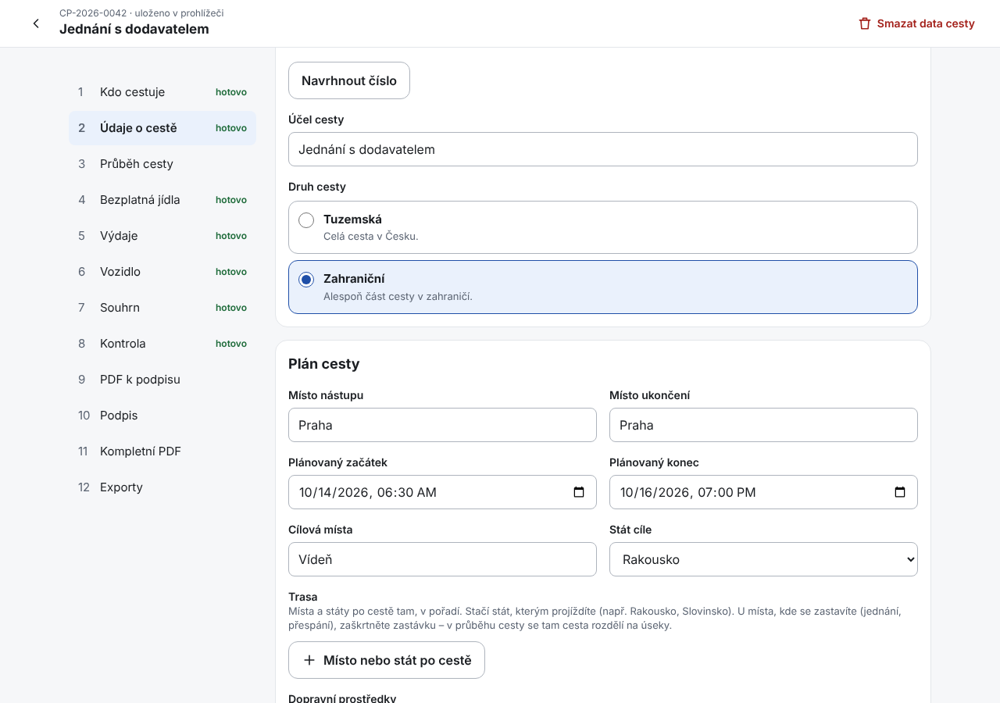 Plán cesty – trasa, dopravní prostředky, záloha |
| 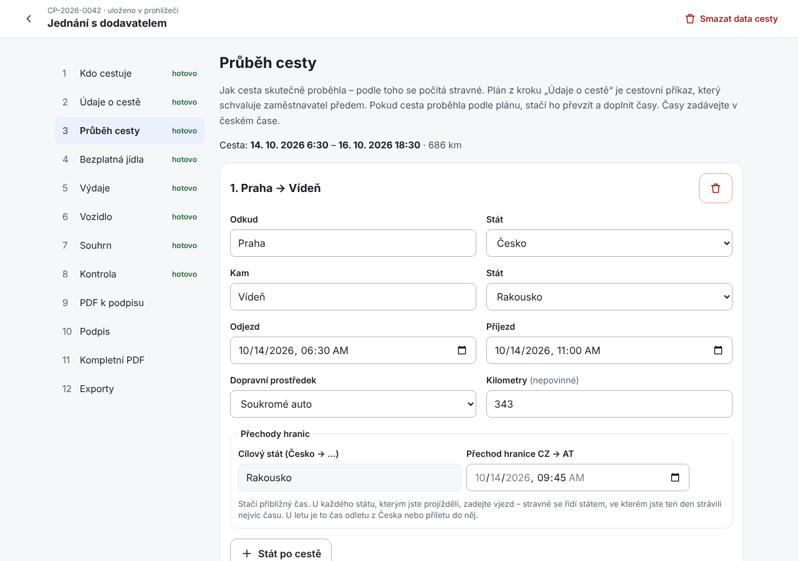 Průběh – úseky a přechody hranic, převzetí z plánu | 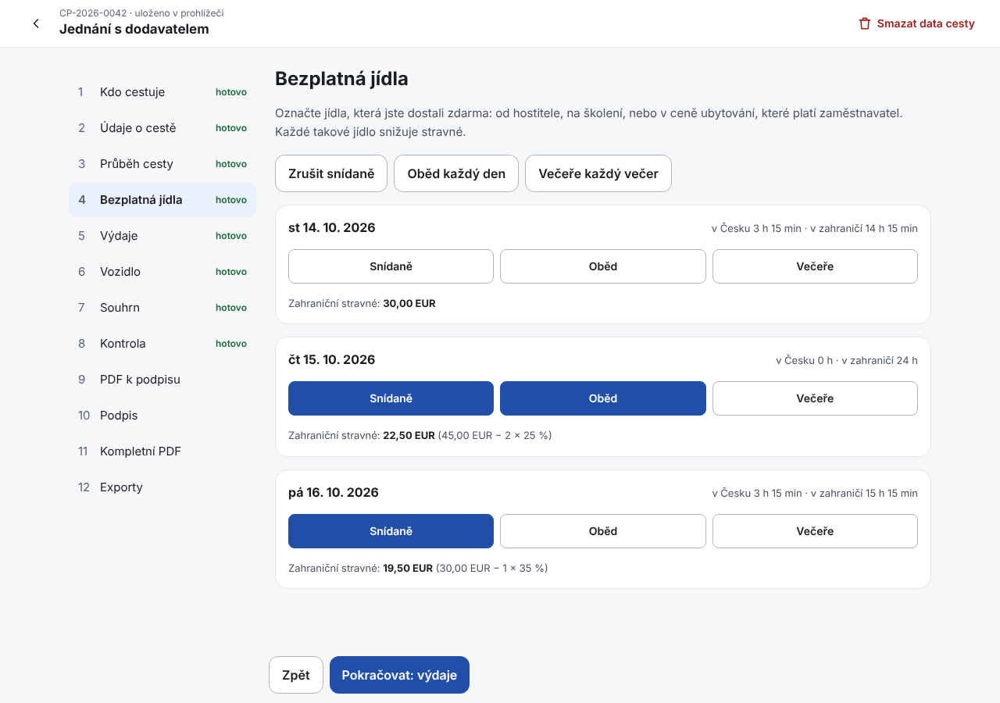 Jídla – krácení stravného je vidět hned u dne |
| 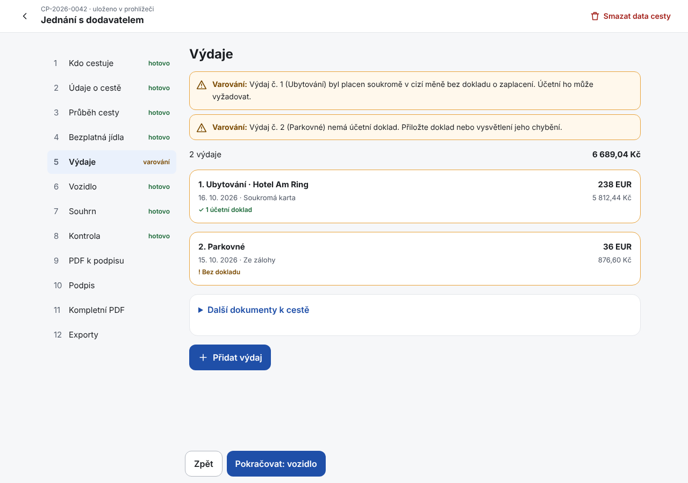 Výdaje – měny, kurzy, doklady, upozornění | 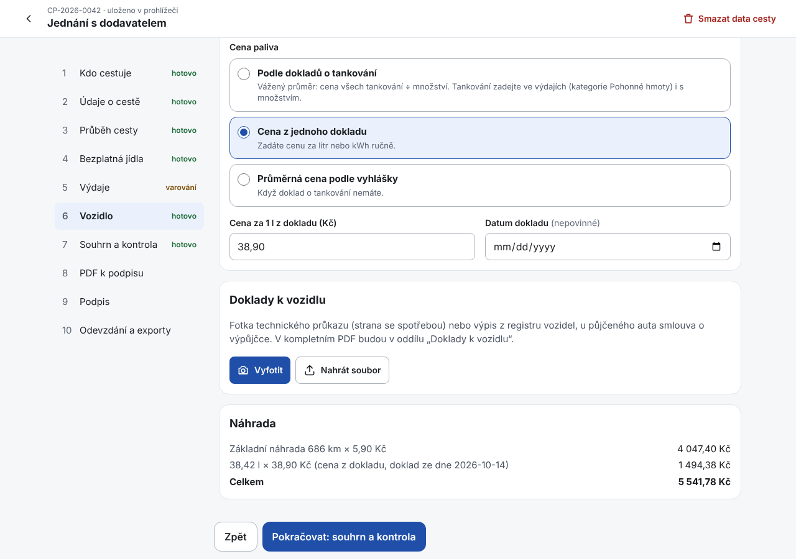 Vozidlo – náhrada za km a palivo |
| 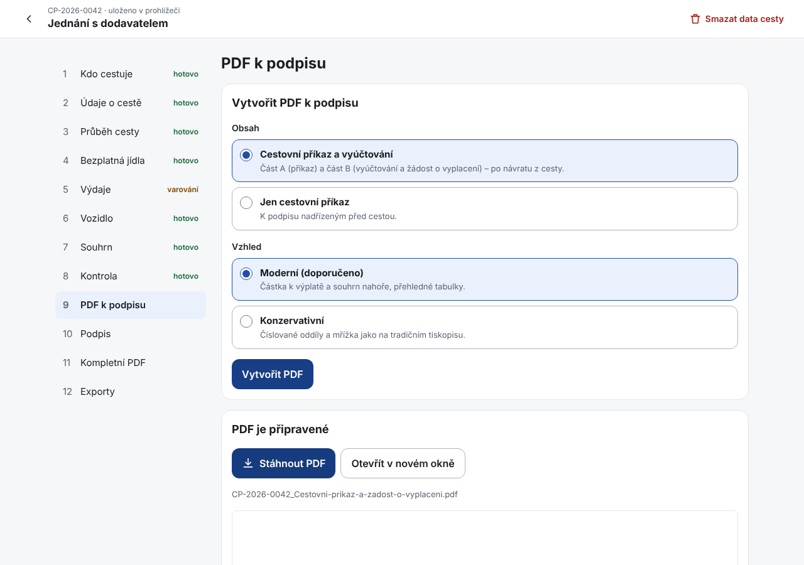 PDF k podpisu – česky nebo anglicky, snímek výpočtu | 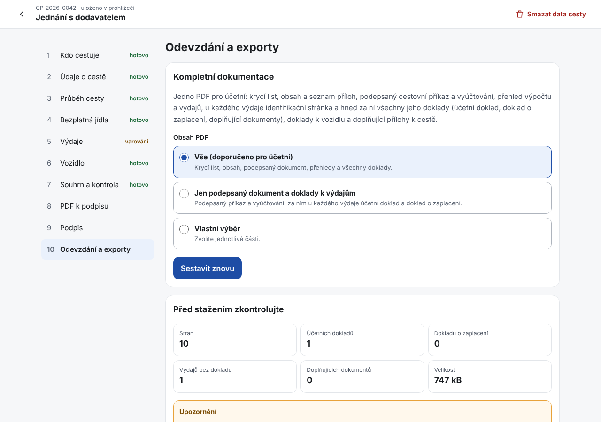 Odevzdání – kompletní PDF, XLSX se vzorci, CSV, JSON, projekt |

Na telefonu:

<p>
  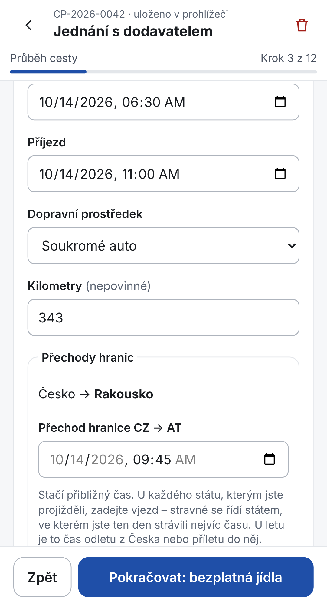
  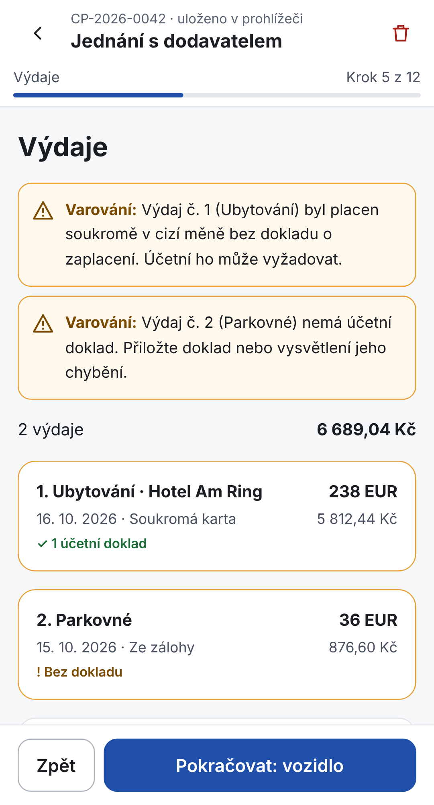
  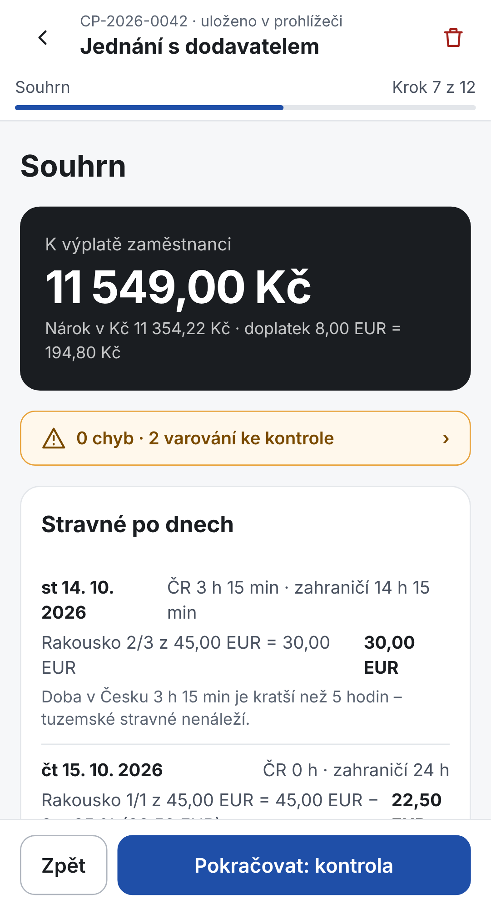
</p>

Výsledné dokumenty ([ukázkové PDF](docs/img/ukazka-cestovni-prikaz.pdf)):

<p>
  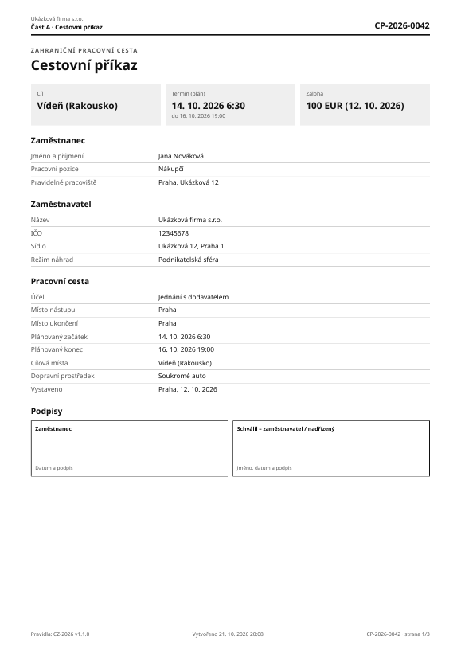
  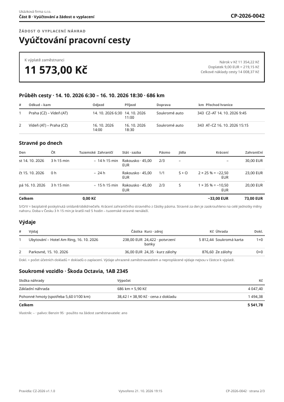
  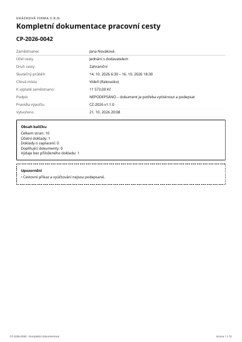
</p>

## Data a soukromí

- Údaje o cestách, doklady i vytvořená PDF jsou **jen v prohlížeči** (IndexedDB). Na server se nic neposílá. Server poskytuje jen soubory aplikace, kurzy ČNB (dotaz obsahuje pouze datum) a vyhledání zaměstnavatele v ARES (dotaz obsahuje pouze zadané IČO nebo název firmy).
- Cesta, kterou nikdo 30 dní neotevře, se automaticky smaže. Týden předem na to aplikace upozorní. Kdykoli jde smazat jednu cestu nebo všechna data.
- Pro práci na jiném zařízení nebo pro archiv slouží **pracovní projekt** (ZIP s daty a originály dokladů). Při načtení se kontrolují kontrolní součty i formát souborů.

## Výpočet a jeho ověření

Výpočet je v samostatném jádru (`packages/core`) s přesnou aritmetikou bez chyb zaokrouhlení v plovoucí čárce a se 166 jednotkovými testy. Sazby jsou v konfiguračním souboru [`packages/rules/data/cz-2026.json`](packages/rules/data/cz-2026.json). Postup aktualizace je v [06 – Aktualizace sazeb](docs/06-aktualizace-sazeb.md).

Sporné body zákoníku práce a praxe (zaokrouhlování, kurzy, více států v jednom dni, cena paliva…) jsou sepsané v [02 – Otázky pro účetní](docs/02-otazky-pro-ucetni.md), u každé otázky i s tím, jak to aplikace dělá teď. **Výsledek vždy kontroluje účetní** – aplikace připravuje podklady, nenahrazuje posouzení zaměstnavatele.

## Vývoj

Potřebujete Node.js 22 a pnpm 10.

```
pnpm install
pnpm --filter @cp/server dev   # server s kurzy ČNB a ARES na http://localhost:8787
pnpm --filter @cp/web dev      # aplikace na http://localhost:5173 (/api přesměruje na server)
pnpm check                     # kontrola typů + jednotkové testy
pnpm e2e                       # testy v prohlížeči (mobil 320 px, mobil, desktop) se zapnutou CSP
```

Screenshoty v README se obnoví příkazem
`SCREENSHOTS=$PWD/docs/img pnpm --filter @cp/web exec playwright test screenshots --project=desktop --project=mobil`.

| Adresář | Obsah |
|---|---|
| `packages/core` | výpočetní jádro: časová osa, stravné, výdaje a kurzy, vozidlo, vyrovnání, kontroly |
| `packages/rules` | sazby a pravidla pro rok 2026, schéma, import přílohy vyhlášky o zahraničním stravném |
| `packages/documents` | PDF k podpisu (React PDF), kompletní dokumentace (pdf-lib), zápis XLSX a CSV |
| `apps/web` | webová aplikace (React, Vite, Tailwind, IndexedDB), E2E testy (Playwright) |
| `apps/server` | API kurzů ČNB a vyhledávání v ARES, bezpečnostní hlavičky – jako server v Node.js (Docker) i jako Cloudflare Worker |

## Nasazení

- **Cloudflare Workers** – po každém sloučení do `main` se aplikace sama sestaví a nasadí, pull requesty mají náhledovou adresu.
- **Docker** – `docker compose up -d --build` spustí aplikaci s HTTPS (Caddy). Hodí se pro vlastní server i firemní síť.

Podrobnosti: [07 – Nasazení a provoz](docs/07-nasazeni.md).

## Dokumentace

| Dokument | Obsah |
|---|---|
| [01 – Analýza](docs/01-analyza.md) | Zadání, rozhodnutí, rizika, návrh MVP a architektury |
| [02 – Otázky pro účetní](docs/02-otazky-pro-ucetni.md) | Legislativní body k potvrzení a jak je aplikace teď řeší |
| [03 – Návrh dokumentů](docs/03-navrh-dokumentu.md) | Dva návrhy PDF s ukázkami |
| [04 – UX návrh](docs/04-ux-navrh.md) | Původní klikací prototyp obrazovek (9 kroků, aplikace má 12) |
| [05 – Technický návrh](docs/05-technicky-navrh.md) | Architektura, výpočetní jádro, PDF, exporty, bezpečnost, nasazení |
| [06 – Aktualizace sazeb](docs/06-aktualizace-sazeb.md) | Nový rok, změna cen paliv, zahraniční stravné, měny a státy, kurzy ČNB |
| [07 – Nasazení a provoz](docs/07-nasazeni.md) | Cloudflare Workers, Docker s HTTPS, firemní síť, proměnné prostředí, bezpečnost |
