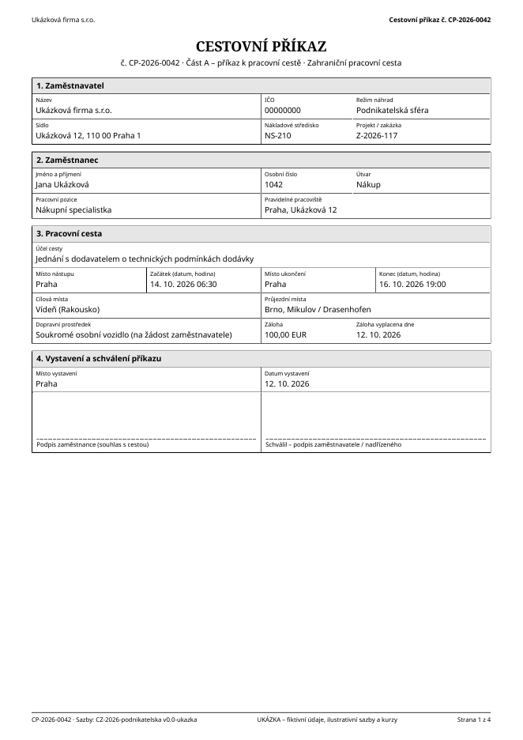
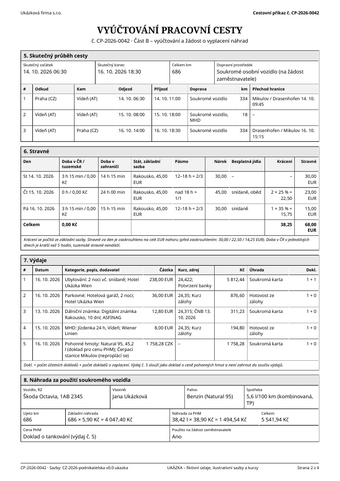
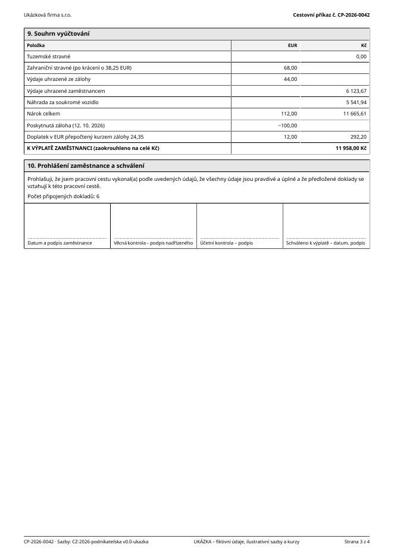
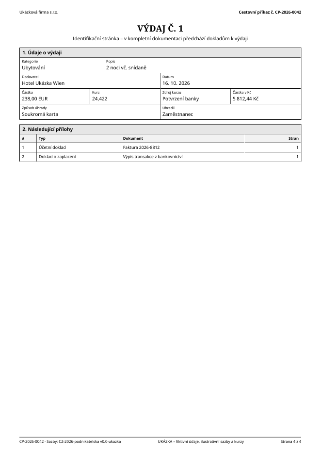
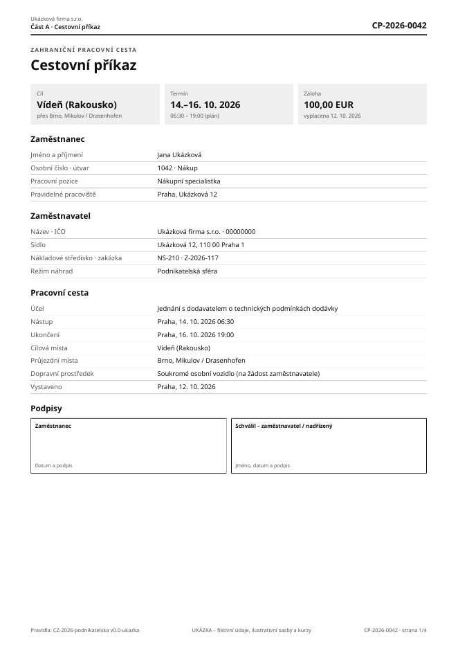
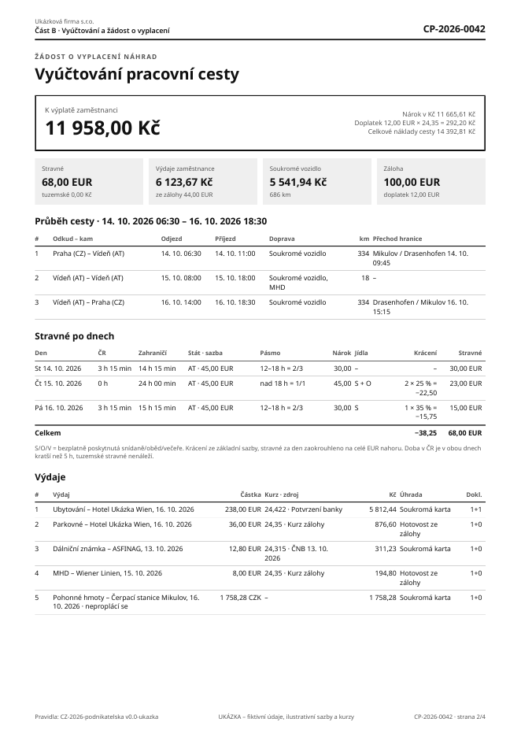
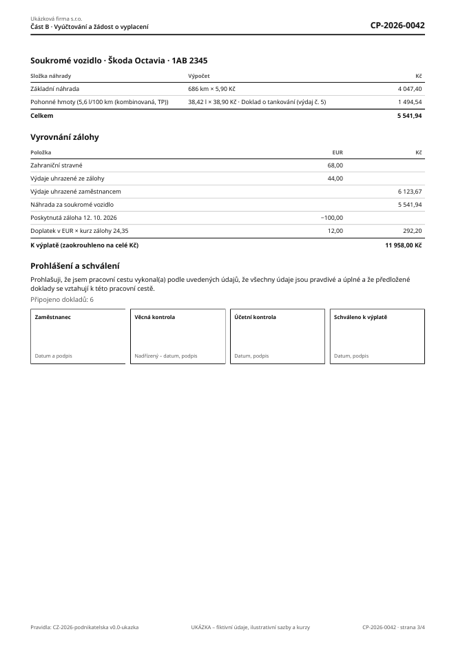
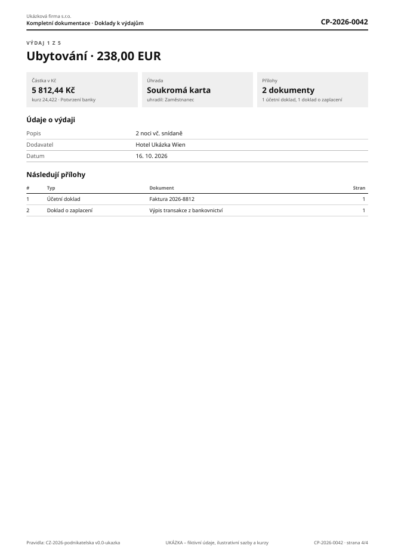

# Etapa 3 – Návrh dokumentů

Dva návrhy výsledného PDF „Cestovní příkaz a žádost o vyplacení“. Oba jsou vygenerované knihovnou `@react-pdf/renderer`, kterou má používat aplikace (zdroj: [`design/pdf-ukazky`](../design/pdf-ukazky)). Ukázky tím zároveň ověřují, že knihovna zvládne české znaky, vložené písmo, číslování stran, zápatí na každé stránce a dělení tabulek mezi stránky.

> **Data jsou fiktivní. Sazby (45 EUR za den pro Rakousko, 5,90 Kč/km) a kurzy jsou pouze ilustrativní,** nejsou převzaté z vyhlášek ani z ČNB. Výpočet v ukázce je zjednodušený a uplatňuje navržené výchozí hodnoty z otázek pro účetní (krácení ze základní sazby, zaokrouhlení stravného na celé EUR nahoru, výsledek na celé Kč). Kontrolní součty: nárok 6 123,67 + 5 541,94 = 11 665,61 Kč, doplatek 12 EUR × 24,35 = 292,20 Kč, celkem 11 957,81 → **11 958 Kč**.

**Ukázková cesta:** Praha – Vídeň – Praha, 14.–16. 10. 2026, soukromé auto, záloha 100 EUR, 5 výdajů ve dvou měnách, hotel placený soukromou kartou s potvrzením z bankovnictví (kurz z potvrzení podle R4), snídaně v ceně hotelu a jeden oběd zdarma.

Každé PDF má 4 strany:
1. Část A – cestovní příkaz s podpisem zaměstnavatele,
2. a 3. Část B – vyúčtování (průběh, stravné po dnech, výdaje, vozidlo, souhrn, prohlášení a podpisy),
4. ukázka identifikační stránky výdaje z kompletní dokumentace.

## Návrh 1 – konzervativní formulářový

PDF: [`CP-2026-0042_…_konzervativni.pdf`](navrh-dokumentu/CP-2026-0042_Cestovni-prikaz-a-zadost-o-vyplaceni_konzervativni.pdf)

| Cestovní příkaz | Vyúčtování | Souhrn a podpisy | Výdaj |
|---|---|---|---|
|  |  |  |  |

Rámečky a mřížka jako u tradičních tiskopisů, číslované oddíly 1–10, popisek nad každou hodnotou.

**Výhody**
- Na tento vzhled jsou účetní zvyklé (tiskopisy cestovních příkazů). Údaje se hledají podle čísla oddílu.
- Mřížka je odolná vůči horšímu skenu a kopírování. Hranice polí zůstanou čitelné.
- Každý údaj má pevné místo, lze se na něj odkazovat („oddíl 6, řádek 2“).
- Jasně ohraničená podpisová pole pro čtyři role.

**Nevýhody**
- Výsledná částka je až na 3. straně ve 9. oddílu. Rychlý přehled chybí.
- Hustá mřížka působí na obrazovce těžkopádně. Na mobilu se čte hůř.
- Dlouhé texty v úzkých buňkách se lámou do více řádků (sloupec stravného).
- Více čar = vizuální šum u jednoduchých cest.

## Návrh 2 – moderní přehledný

PDF: [`CP-2026-0042_…_moderni.pdf`](navrh-dokumentu/CP-2026-0042_Cestovni-prikaz-a-zadost-o-vyplaceni_moderni.pdf)

| Cestovní příkaz | Vyúčtování | Vozidlo, souhrn a podpisy | Výdaj |
|---|---|---|---|
|  |  |  |  |

Výsledná částka a souhrnné bloky hned nahoře, tabulky jen s vodorovnými linkami, šedé podklady.

**Výhody**
- Částka k výplatě a skladba nároku jsou vidět okamžitě. Kontrola je rychlejší, zejména u jednoduchých cest.
- Vzdušnější a lépe čitelné na obrazovce (elektronické předání, náhled v aplikaci).
- Širší sloupce tabulek, méně lámání řádků.
- Identifikační stránka výdaje je výrazná, a v kompletní dokumentaci se proto mezi doklady snadno hledá.

**Nevýhody**
- Šedé podklady mohou na levné tiskárně nebo při skenování vyblednout. Text v nich je proto vždy černý a podklad slouží jen jako doplněk.
- Méně „úřední“ vzhled. Někteří účetní mohou preferovat tradiční tiskopis.
- Bez číslovaných oddílů se na údaj hůř odkazuje.

## Společné vlastnosti obou návrhů

- Číslo cestovního příkazu je na každé stránce (záhlaví i zápatí), číslování „strana X z Y“.
- Verze pravidel a sazeb je v zápatí každé stránky.
- Pouze černá a odstíny šedé, čitelné černobíle.
- Bez loga funguje přirozeně. S logem se logo vloží do záhlaví vlevo místo názvu firmy (max. výška 12 mm).
- Písmo Noto Sans (licence OFL) je vložené do PDF, takže je stejné na všech zařízeních a podporuje české i zahraniční znaky.
- Podpisová pole jsou vysoká přibližně 2,4 cm (konzervativní) a 2,5 cm (moderní).
- Vlastnosti dokumentu (název, autor, jazyk `cs`).

## Doporučení

Navrhuji **moderní variantu jako výchozí** a konzervativní jako volbu v aplikaci. Implementační náklad druhé varianty je malý, protože obě šablony čtou stejný snímek výpočtu.

Moderní variantu bych upravil o **číslování oddílů** z konzervativní varianty (malé číslo u nadpisu), aby se na údaje dalo odkazovat.

Konečnou volbu doporučuji nechat na účetní, protože dokument čte hlavně ona (viz [Ú-19](02-otazky-pro-ucetni.md)).

## Technická zjištění z ukázek

- `@react-pdf/renderer` 4.9 funguje dobře, výsledné PDF má 35–55 kB.
- Chyba knihovny: nastavení `lineHeight` na úrovni stránky způsobí, že se nevykreslí pevně umístěné zápatí. Řádkování se proto nastavuje jen u jednotlivých textových stylů.
- Písmo Noto Sans neobsahuje znak šipky „→“. V šablonách se používají jen znaky, které písmo obsahuje. Před nasazením přidám test, který ověří pokrytí všech znaků použitých v šablonách.
- Číslování stran napříč sloučenými přílohami v kompletní dokumentaci obstará `pdf-lib` (doplní se po sloučení). Ověřím v milníku 5.
