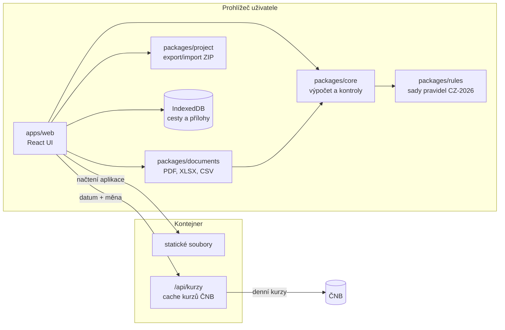

# Etapa 4 – Technický návrh

Navazuje na schválenou [analýzu](01-analyza.md) (lokální architektura, R10). Výpočetní jádro z milníku 1 je už implementované a tento dokument popisuje jeho skutečnou podobu.

## 1. Technologie

| Vrstva | Volba |
|---|---|
| Jazyk | TypeScript (strict) |
| Monorepo | pnpm workspaces |
| UI | React 19 + Vite (SPA), React Router, React Hook Form, zod |
| Styl | Tailwind CSS, přístupné komponenty Radix UI, písmo Inter (self-hosted) |
| Lokální úložiště | IndexedDB přes Dexie |
| PDF | `@react-pdf/renderer` (šablony), `pdf-lib` (slučování, číslování, záložky, podpis), `pdf.js` (náhledy) |
| Obrázky | canvas API, `heic2any`, `exifr` |
| Exporty | ExcelJS (XLSX), vlastní CSV, `fflate` (ZIP) |
| Testy | Vitest (jádro, dokumenty), Playwright (E2E, mobilní viewporty, WebKit) |
| Server | Node.js + Hono: statické soubory a `/api/kurzy` |
| Nasazení | Docker (multi-stage), Docker Compose, Caddy (HTTPS) |

### Porovnání s variantou .NET

| Kritérium | TypeScript (zvoleno) | ASP.NET Core + Blazor |
|---|---|---|
| Výpočty a PDF v prohlížeči (R6) | přirozené, jeden jazyk pro jádro i UI | Blazor WebAssembly jde, ale velký balík (MB) a slabší knihovny pro PDF v prohlížeči |
| Sdílení jádra s budoucím serverem | stejný balíček `@cp/core` v Node | stejné C# jádro na serveru i ve WASM |
| Mobilní výkon a start aplikace | rychlý (stovky kB) | pomalejší první načtení |
| Firemní provoz | Docker kontejner | Docker nebo IIS |
| Vhodné, když | tým zná web a JS | firma má .NET tým a chce hlavně serverovou aplikaci |

Pro lokální architekturu, kde se vše počítá v prohlížeči, je TypeScript jasně vhodnější. Serverovou část budoucí firemní verze lze napsat v čemkoliv, protože pravidla jsou data (JSON) a jádro má jasné rozhraní.

## 2. Architektura



- Na server neodchází žádný osobní údaj. Požadavek na kurz obsahuje jen datum.
- `core`, `rules`, `documents` a `project` nezávisí na prohlížeči, takže je může použít budoucí server.
- Modulární monolit: jedna aplikace, jeden kontejner.

## 3. Datový model

Vstup výpočtu je typ `TripInput` v [`packages/core/src/model.ts`](../packages/core/src/model.ts). Zásady:

- Částky jsou celá čísla v nejmenších jednotkách měny (haléře, centy) plus kód měny.
- Kurzy a desetinné vstupy (km, spotřeba) jsou text, aby nevznikaly chyby plovoucí čárky.
- Časy jsou v českém místním čase `YYYY-MM-DDTHH:mm` (Ú-9).
- Přechody hranic jsou součástí úseků. Z nich jádro sestaví intervaly pobytu ve státech.

Uložená cesta v aplikaci (IndexedDB) obsahuje navíc údaje pro dokumenty (zaměstnanec, zaměstnavatel, účel, plán, poznámky) a metadata příloh. Je to nadmnožina `TripInput` se `schemaVersion`.

```
trips        { id, schemaVersion, createdAt, updatedAt, lastOpenedAt, data: TripDocument }
attachments  { id, tripId, expenseId?, kind, subtype, originalName, mime, size, sha256, order, createdAt }
blobs        { attachmentId, variant: 'original' | 'derived' | 'thumbnail', blob }
snapshots    { id, tripId, createdAt, ruleSetId, ruleSetVersion, inputHash, result, documentKind }
settings     { key, value }   // zapamatovaný zaměstnanec a zaměstnavatel, doba uchování
```

Připraveno pro budoucí firemní verzi: UUID místo pořadových čísel, volitelné `ownerId` a `organizationId`, odděleně uložené výsledky výpočtu (snímky).

## 4. Výpočetní jádro (milník 1, hotovo)

```ts
calculate(trip: TripInput, ruleSets?: RuleSet[]): CalculationResult
```

- Je to **čistá funkce**: nečte aktuální čas, síť ani úložiště. Kurzy ČNB dodá aplikace ve vstupu.
- Počítá v přesných zlomcích (BigInt) a zaokrouhluje jen tam, kde to určuje sada pravidel.
- Postup: kontrola a sestavení časové osy → rozdělení na kalendářní dny (včetně dnů se změnou času) → minuty v ČR a v jednotlivých státech → tuzemské a zahraniční stravné s krácením → kapesné → vozidlo → výdaje a kurzy → vyrovnání záloh po měnách → výsledek k výplatě.
- Výsledek obsahuje všechny mezivýpočty pro rozpis v UI a PDF a seznam `issues` (chyba / varování / informace) se stabilními kódy a českými zprávami včetně rady, jak problém opravit.
- `ok: false` znamená blokující chybu, při které nelze vytvořit PDF.

### Sady pravidel

[`packages/rules/data/cz-2026.json`](../packages/rules/data/cz-2026.json) se při načtení validuje schématem zod. Obsahuje:

| Údaj | Hodnota 2026 | Zdroj |
|---|---|---|
| Tuzemské stravné, podnikatelská sféra (minimum) | 155 / 236 / 370 Kč | 573/2025 Sb. |
| Tuzemské stravné, platová sféra (rozpětí) | 155–185 / 236–284 / 370–442 Kč | 573/2025 Sb. |
| Základní náhrada za 1 km | osobní auto 5,90 Kč, motocykl 1,60 Kč | 573/2025 Sb. |
| Benzin 95 | 34,70 Kč (do 30. 9.), 41,80 Kč (od 1. 10.) | 573/2025, 175/2026 Sb. |
| Benzin 98 | 39,00 Kč | 573/2025 Sb. |
| Nafta | 34,10 Kč (do 31. 5.), 44,50 Kč (od 1. 6.) | 573/2025, 78/2026 Sb. |
| Elektřina | 7,20 Kč/kWh | 573/2025 Sb. |
| Zahraniční stravné | AT 45, DE 50, FR 50, IT 55, PL 50, SK 40 EUR; HU 50 EUR a GB 45 GBP neověřeno | 489/2025 Sb. |

> **Stav ověření:** hodnoty pocházejí ze shodných sekundárních zdrojů (odborné weby). Primární texty vyhlášek (mf.gov.cz, ppropo.mpsv.cz) nebyly z vývojového prostředí dostupné. Před ostrým provozem je musí ověřit účetní. Zahraniční stravné obsahuje zatím jen sousední a nejčastější státy. U ostatních aplikace vyžádá ruční zadání sazby podle vyhlášky a upozorní na to. Doplnění celé přílohy vyhlášky (cca 170 států) je úkol pro milník 3.

Nová sada pravidel = nový soubor (např. `cz-2027.json`) + test s kontrolními hodnotami. Stará sada zůstává, takže výpočty starších cest se nezmění.

### Pokrytí testy

60 automatických testů porovnává skutečné částky s ručně spočítanými. Pokrývají všechny případy ze zadání § 29.1: jednodenní, vícedenní a krátkou cestu, bezplatná jídla, zahraniční cestu do jedné země, průjezd více státy, hranici kolem půlnoci, kombinaci tuzemského a zahraničního stravného, více měn, zálohu v cizí měně, doložený i ruční kurz, vozidlo s doloženou i průměrnou cenou, firemní a soukromou platbu, doplatek i přeplatek a zaokrouhlování. Navíc: dny se změnou času, hraniční časy pásem, platová sféra, kapesné, elektromobil a kontroly časové osy.

Kontrola testů mutací: po změně jediné sazby selže 11 testů.

## 5. Kurzy ČNB

- `GET /api/kurzy?datum=YYYY-MM-DD` vrátí denní kurzy ČNB platné pro dané datum (ČNB vyhlašuje kurzy v pracovní dny po 14:30. Pro víkend a svátek platí poslední vyhlášený kurz).
- Server stahuje pouze z pevně dané adresy ČNB, výsledky ukládá do cache v paměti a na disk (kurzy se zpětně nemění). Rate limiting v Caddy.
- Aplikace uloží ke každé částce kurz, datum kurzu a zdroj. Výpočet je tím reprodukovatelný i bez sítě.
- Výchozí datum kurzu pro výdaj je den platby (návrh, otevřená otázka Ú-10).

## 6. Přílohy

1. Výběr nebo vyfocení souboru → ověření typu podle prvních bajtů (PDF, JPEG, PNG, HEIC), limit 20 MB.
2. Výpočet SHA-256 → kontrola duplicit.
3. Uložení originálu (nikdy se nepřepisuje) a odvozené varianty: HEIC → JPEG, otočení podle EXIF, zmenšení na delší stranu 2 400 px, ořez a otočení podle uživatele.
4. Náhled: obrázky přes ``, PDF přes `pdf.js` vykreslené do canvasu (bez spouštění skriptů v PDF).

## 7. Generování PDF

1. **Snímek:** při kliknutí na „Vytvořit PDF“ se uloží `snapshot` = vstup + výsledek výpočtu + verze pravidel + hash vstupu. Šablony čtou jen snímek.
2. **PDF k podpisu:** `@react-pdf/renderer` ve Web Workeru (UI nezamrzne), vložené písmo Noto Sans.
3. **Kompletní dokumentace:** `pdf-lib` složí krycí list a obsah, podepsaný dokument (sken nebo PDF s vloženým PNG podpisem), rozpis výpočtu, přehled výdajů a pro každý výdaj identifikační stranu a doklady (obrázek = stránka A4 se zachovaným poměrem stran, PDF = vložení stran). Potom doplní průběžné číslování „strana X z Y“, číslo příkazu a záložky.
4. Před stažením se zobrazí počet stran, dokladů a výdajů bez dokladu a velikost souboru. Cíl je pod 10 MB při 30 fotkách díky zmenšení na 200 DPI a JPEG kvalitě 0,8.

## 8. Export a import projektu

```
CP-2026-0042_projekt.zip
├── project.json        { schemaVersion, applicationVersion, exportedAt, trip, attachments[] (metadata) }
├── manifest.json       { files: [{ path, sha256, size }] }
└── attachments/<id>.<přípona>
```

Import: limit počtu souborů (500) a rozbalené velikosti (500 MB), přijetí jen souborů z manifestu, kontrola SHA-256, validace `project.json` schématem a migrace starších verzí schématu. Cesty v ZIP se nikdy nepoužijí jako cesty na disku. Při chybě se zobrazí srozumitelná česká hláška a nic se neuloží.

## 9. Bezpečnost

- Přísná CSP: `default-src 'self'; script-src 'self'; img-src 'self' blob: data:; connect-src 'self'; frame-ancestors 'none'`.
- Žádné skripty, fonty ani analytika třetích stran. `Referrer-Policy: no-referrer`, `X-Content-Type-Options: nosniff`, HSTS.
- React escapuje výstup. `dangerouslySetInnerHTML` je zakázané lint pravidlem.
- Endpoint kurzů přijímá jen validované datum, volá pevnou adresu (bez SSRF) a má rate limit.
- Závislosti: lockfile, `pnpm audit` v CI, Dependabot.

## 10. Automatické mazání

- Každá cesta má `lastOpenedAt`. Při spuštění aplikace se smažou cesty starší než nastavená doba (výchozí 30 dní), včetně příloh a snímků, v jedné transakci IndexedDB.
- 7 dní před smazáním aplikace na cestu upozorní a nabídne stažení projektu.
- Ruční smazání cesty i všech dat aplikace. Test s posunutým časem ověří, že po smazání v IndexedDB nic nezůstane.
- Aplikace požádá prohlížeč o trvalé úložiště (`navigator.storage.persist()`).

## 11. Testování

| Úroveň | Nástroj | Co |
|---|---|---|
| Jednotkové | Vitest | výpočty (hotovo), převody času, kurzy, CSV/XLSX, import ZIP včetně škodlivých balíčků |
| Dokumenty | Vitest + pdf-lib | počet stran, čísla stran, záložky, české znaky, pořadí příloh, otočené a extrémní obrázky, poškozené soubory |
| E2E | Playwright | celý tok na 320 px, mobilu, tabletu a desktopu, Chromium a WebKit |
| Přístupnost | axe-core v Playwright | každá obrazovka bez závažných nálezů |
| CI | GitHub Actions | typecheck + testy u každého PR |

## 12. Nasazení

- Jeden obraz `ghcr.io/javor55/cestovni-prikazy`: Node server se statickými soubory a `/api/kurzy`.
- `docker-compose.yml` s Caddy pro HTTPS (Let's Encrypt).
- Konfigurace proměnnými prostředí: `PORT`, `CNB_URL`, `RATE_CACHE_DIR`, `RETENTION_DAYS_DEFAULT`.
- **Internet:** Ubuntu VM s veřejnou IP a doménou (nebo bezplatná subdoména).
- **Firemní síť:** stejný obraz. Pokud server nesmí ven, `/api/kurzy` lze vypnout, aplikace pak nabídne ruční zadání kurzu nebo import kurzovního lístku ČNB (TXT).

## 13. Další milníky

| Milník | Obsah |
|---|---|
| 1 | **Výpočetní jádro a sady pravidel – hotovo** |
| 2 | **Kostra webové aplikace, průvodce formuláři, lokální ukládání, validace v UI, napojení na jádro – hotovo** |
| 3 | **Přílohy (focení, HEIC, ořez, otočení), kurzy ČNB – hotovo**; úplná tabulka zahraničních sazeb čeká na text přílohy vyhlášky (nástroj pro import je hotový) |
| 4 | **PDF k podpisu (obě šablony) ze snímku výpočtu – hotovo** |
| 5 | Podepsaný dokument, PNG podpis, kompletní PDF |
| 6 | Exporty XLSX, CSV, JSON a export/import projektu |
| 7 | Zabezpečení, PWA manifest, Docker, dokumentace, testovací nasazení |
