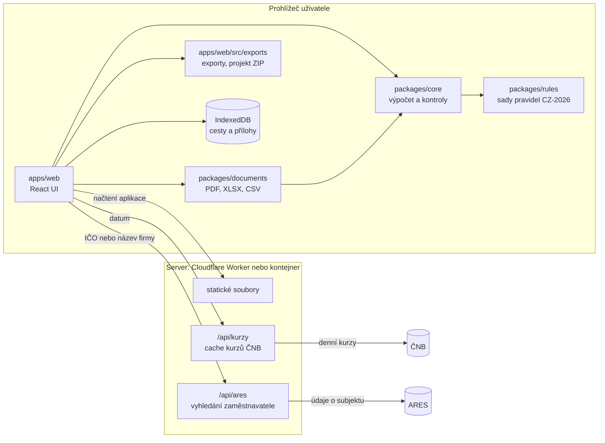

# Etapa 4 – Technický návrh

Navazuje na schválenou [analýzu](01-analyza.md) (lokální architektura, R10). Všechny milníky 1–7 jsou hotové a dokument popisuje skutečný stav aplikace (aktualizováno 21. 10. 2026).

## 1. Technologie

| Vrstva | Volba |
|---|---|
| Jazyk | TypeScript (strict) |
| Monorepo | pnpm workspaces |
| UI | React 19 + Vite (SPA), React Router, zod (kontrola importovaných dat) |
| Styl | Tailwind CSS 4, vlastní přístupné komponenty (`apps/web/src/ui`), písmo Inter (self-hosted, `@fontsource`) |
| Lokální úložiště | IndexedDB přes Dexie |
| PDF | `@react-pdf/renderer` (šablony), `pdf-lib` (slučování, číslování, záložky, podpis), `pdf.js` (náhledy) |
| Obrázky | canvas API, `heic2any`, otočení podle EXIF přes `createImageBitmap` |
| Exporty | vlastní zápis XLSX (SpreadsheetML) a CSV, `fflate` (ZIP); ExcelJS jen v testech ke kontrole souboru |
| Testy | Vitest (jádro, pravidla, dokumenty, aplikace, server), Playwright (E2E v Chromiu: 320 px, mobil, desktop; axe-core) |
| Server | Hono: `/api/kurzy`, `/api/ares` a bezpečnostní hlavičky – jako server v Node.js (Docker, i statické soubory) nebo jako Cloudflare Worker |
| Nasazení | Cloudflare Workers (`wrangler.toml`), Docker (multi-stage), Docker Compose, Caddy (HTTPS) |

### Porovnání s variantou .NET

| Kritérium | TypeScript (zvoleno) | ASP.NET Core + Blazor |
|---|---|---|
| Výpočty a PDF v prohlížeči (R6) | přirozené, jeden jazyk pro jádro i UI | Blazor WebAssembly jde, ale velký balík (MB) a slabší knihovny pro PDF v prohlížeči |
| Sdílení jádra s budoucím serverem | stejný balíček `@cp/core` v Node | stejné C# jádro na serveru i ve WASM |
| Mobilní výkon a start aplikace | rychlý (stovky kB) | pomalejší první načtení |
| Firemní provoz | Docker kontejner | Docker nebo IIS |
| Vhodné, když | tým zná web a JS | firma má .NET tým a chce hlavně serverovou aplikaci |

Pro lokální architekturu, kde se vše počítá v prohlížeči, je TypeScript jasně vhodnější. Serverovou část budoucí firemní verze lze napsat v čemkoliv, protože pravidla jsou data (JSON) a jádro má jasné rozhraní.

## 2. Architektura



- Na server neodchází žádný osobní údaj. Požadavek na kurz obsahuje jen datum, vyhledání v ARES jen zadané IČO nebo název firmy.
- `core`, `rules` a `documents` nezávisí na prohlížeči, takže je může použít budoucí server.
- Modulární monolit: jedna aplikace, jeden kontejner.

## 3. Datový model

Vstup výpočtu je typ `TripInput` v [`packages/core/src/model.ts`](../packages/core/src/model.ts). Zásady:

- Částky jsou celá čísla v nejmenších jednotkách měny (haléře, centy) plus kód měny.
- Kurzy a desetinné vstupy (km, spotřeba) jsou text, aby nevznikaly chyby plovoucí čárky.
- Časy jsou v českém místním čase `YYYY-MM-DDTHH:mm` (Ú-9).
- Přechody hranic jsou součástí úseků – jeden úsek jich může mít víc (průjezd více státy). Z nich jádro sestaví intervaly pobytu ve státech.

Uložená cesta v aplikaci (IndexedDB, typ `TripDoc` v [`apps/web/src/model/trip.ts`](../apps/web/src/model/trip.ts)) obsahuje navíc údaje pro dokumenty: zaměstnanec, zaměstnavatel, účel, plán s trasou (`route[]` se zastávkami) a dopravními prostředky (`plannedTransportKinds`, včetně půjčeného auta, autopůjčovny a lodi), poznámky. Formulářová čísla zůstávají textem a na vstup jádra je převádí `toInput.ts`. Aktuální verze schématu je 7. Starší uložené cesty i importované projekty převádí `migrate.ts`.

```
trips        TripDoc { id, schemaVersion, createdAt, updatedAt, lastOpenedAt, … }
attachments  { id, tripId, expenseId | null, kind, subtype, originalName, mime, size, sha256, order, createdAt, rotation, crop, conversion, pages }
blobs        { key: "<attachmentId>:<variant>", attachmentId, variant: 'original' | 'derived' | 'thumbnail', blob }
snapshots    { id, tripId, createdAt, layout, part, inputHash, model: DocModel }   // neměnný snímek dokumentu
settings     { key, value }   // zapamatovaný zaměstnanec a zaměstnavatel
```

Připraveno pro budoucí firemní verzi: UUID místo pořadových čísel, volitelné `ownerId` a `organizationId`, odděleně uložené výsledky výpočtu (snímky).

## 4. Výpočetní jádro

```ts
calculate(trip: TripInput, ruleSets?: RuleSet[]): CalculationResult
```

- Je to **čistá funkce**: nečte aktuální čas, síť ani úložiště. Kurzy ČNB dodá aplikace ve vstupu.
- Počítá v přesných zlomcích (BigInt) a zaokrouhluje jen tam, kde to určuje sada pravidel.
- Zaokrouhlení určuje `rounding` v sadě pravidel: tuzemské stravné za den nahoru na celé Kč, zahraniční stravné se nezaokrouhluje (`NONE`, od verze 1.2.0 podle výpočtu účetní – den se zobrazí na centy, ale sčítá a přepočítává se přesná hodnota), výplata matematicky na celé Kč.
- Postup: kontrola a sestavení časové osy → rozdělení na kalendářní dny (včetně dnů se změnou času) → minuty v ČR a v jednotlivých státech → tuzemské a zahraniční stravné s krácením → kapesné → vozidlo → výdaje a kurzy → vyrovnání záloh po měnách → výsledek k výplatě.
- Výsledek obsahuje všechny mezivýpočty pro rozpis v UI a PDF a seznam `issues` (chyba / varování / informace) se stabilními kódy a českými zprávami včetně rady, jak problém opravit.
- `ok: false` znamená blokující chybu, při které nelze vytvořit PDF.

### Sady pravidel

[`packages/rules/data/cz-2026.json`](../packages/rules/data/cz-2026.json) se při načtení validuje schématem zod. Obsahuje:

| Údaj | Hodnota 2026 | Zdroj |
|---|---|---|
| Tuzemské stravné, podnikatelská sféra (minimum) | 155 / 236 / 370 Kč | 573/2025 Sb. |
| Tuzemské stravné, platová sféra (rozpětí) | 155–185 / 236–284 / 370–442 Kč | 573/2025 Sb. |
| Základní náhrada za 1 km | osobní auto 5,90 Kč, motocykl 1,60 Kč | 573/2025 Sb. |
| Benzin 95 | 34,70 Kč (do 30. 9.), 41,80 Kč (od 1. 10.) | 573/2025, 175/2026 Sb. |
| Benzin 98 | 39,00 Kč | 573/2025 Sb. |
| Nafta | 34,10 Kč (do 31. 5.), 44,50 Kč (od 1. 6.) | 573/2025, 78/2026 Sb. |
| Elektřina | 7,20 Kč/kWh | 573/2025 Sb. |
| Zahraniční stravné | úplná příloha: 227 států a území (např. AT 45, DE 50, HR 50 EUR, GB 45 GBP, CH 75 CHF, US 70 USD), ostatní země 35 EUR | 489/2025 Sb. |

> **Stav ověření:** zahraniční stravné je převzaté z PDF vyhlášky 489/2025 Sb. od Ministerstva financí (od verze sady 1.1.0). Tuzemské sazby, náhrada za km a ceny paliv pocházejí ze shodných sekundárních zdrojů. Primární texty vyhlášek nebyly z vývojového prostředí dostupné, před ostrým provozem je musí ověřit účetní. Každý zdroj v `sources` má odkaz (`url`) na úplné znění. Aplikace ho ukazuje v Souhrnu.

Nová sada pravidel = nový soubor (např. `cz-2027.json`) + test s kontrolními hodnotami. Stará sada zůstává, takže výpočty starších cest se nezmění.

### Pokrytí testy

Přes 60 testů jádra (z celkem asi 170 jednotkových testů) porovnává skutečné částky s ručně spočítanými. Pokrývají všechny případy ze zadání § 29.1: jednodenní, vícedenní a krátkou cestu, bezplatná jídla, zahraniční cestu do jedné země, průjezd více státy, hranici kolem půlnoci, kombinaci tuzemského a zahraničního stravného, více měn, zálohu v cizí měně, doložený i ruční kurz, vozidlo s doloženou i průměrnou cenou, firemní a soukromou platbu, doplatek i přeplatek a zaokrouhlování. Navíc: dny se změnou času, hraniční časy pásem, platová sféra, kapesné, elektromobil a kontroly časové osy.

Kontrola testů mutací: po změně jediné sazby selže 11 testů.

## 5. Kurzy ČNB

- `GET /api/kurzy?datum=YYYY-MM-DD` vrátí denní kurzy ČNB platné pro dané datum (ČNB vyhlašuje kurzy v pracovní dny po 14:30. Pro víkend a svátek platí poslední vyhlášený kurz).
- Server stahuje pouze z pevně dané adresy ČNB (nastavitelné přes `CNB_URL`). Výsledky ukládá do mezipaměti v paměti a v Dockeru i na disk (kurzy se zpětně nemění), na Cloudflare do jeho mezipaměti. Limit počtu požadavků je přímo v serveru (`RATE_LIMIT_PER_MINUTE`, výchozí 60 za minutu z jedné adresy).
- Aplikace uloží ke každé částce kurz, datum kurzu a zdroj. Výpočet je tím reprodukovatelný i bez sítě.
- Tlačítko „Načíst kurz ČNB“ bere kurz ke dni výdaje, u zahraničního stravného bez zálohy ke dni začátku cesty (otevřená otázka Ú-10).

## 5a. Vyhledání zaměstnavatele v ARES

- `GET /api/ares?ico=…` nebo `GET /api/ares?nazev=…` vrátí subjekty z ARES (veřejné REST API Ministerstva financí, bez registrace) ve zjednodušeném tvaru: název, IČO, sídlo jako jeden řádek, kód právní formy, příznak platové sféry a případné datum zániku.
- Prohlížeč se na ARES nepřipojuje přímo (CSP povoluje připojení jen k vlastní doméně). Server kontroluje vstup (IČO 8 číslic s kontrolní číslicí, bez úvodních nul se doplní; název 3–100 znaků), vrací nejvýše 10 výsledků a odpovědi drží 24 hodin v paměti. Platí pro něj stejný limit požadavků jako pro kurzy.
- Krok „Kdo cestuje“: zadané číslice se hledají jako IČO a jediný výsledek se doplní rovnou, text se hledá jako název a uživatel vybere ze seznamu. Doplní se název, IČO a sídlo, pole jdou dál ručně upravit. U právní formy organizační složky státu, příspěvkové organizace, obce, kraje nebo městské části se nastaví platová sféra s upozorněním ke kontrole.
- Pole IČO hlásí chybu, když nesedí kontrolní číslice.

## 6. Přílohy

1. Výběr nebo vyfocení souboru → ověření typu podle prvních bajtů (PDF, JPEG, PNG, HEIC), limit 20 MB na soubor a 300 MB na cestu. Druhy: účetní doklad, doklad o zaplacení, doplňující dokument, doklad k vozidlu (technický průkaz, výpis z registru, smlouva o výpůjčce), podepsaný sken, obrázek podpisu.
2. Výpočet SHA-256 → kontrola duplicit.
3. Uložení originálu (nikdy se nepřepisuje) a odvozené varianty: HEIC → JPEG, otočení podle EXIF, zmenšení na delší stranu 2 400 px, ořez a otočení podle uživatele.
4. Náhled: obrázky přes ``, PDF přes `pdf.js` vykreslené do canvasu (bez spouštění skriptů v PDF).

## 7. Generování PDF

1. **Snímek:** při kliknutí na „Vytvořit PDF“ se uloží `snapshot` = model dokumentu (`DocModel` – všechny údaje už naformátované jako text, včetně verze pravidel) + obsah (celý dokument / jen část A) + otisk vstupních údajů. Jazyk (`lang`: cs/en) je součástí modelu. Šablony čtou jen snímek, takže stejný snímek dá vždy stejné PDF.
2. **PDF k podpisu:** `@react-pdf/renderer` v prohlížeči (knihovna se načte až při prvním použití), jeden vzhled česky nebo anglicky (pevné popisky v `packages/documents/src/labels.ts`, číselníky a poznámky přeloží `apps/web/src/documents/i18n.ts`), vložená písma Noto Sans a Noto Serif Bold. Test hlídá, že písmo obsahuje všechny znaky šablon.
3. **Kompletní dokumentace:** `pdf-lib` složí krycí list a obsah, podepsaný dokument (sken nebo PDF s vloženým PNG podpisem), rozpis výpočtu, přehled výdajů, pro každý výdaj identifikační stranu a hned za ní všechny jeho doklady (účetní doklad, doklad o zaplacení, doplňující dokumenty), potom doklady k vozidlu a doplňující přílohy k cestě (obrázek = stránka A4 se zachovaným poměrem stran, PDF = vložení stran). Potom doplní průběžné číslování „strana X z Y“, číslo příkazu a záložky.
4. Před stažením se zobrazí počet stran, dokladů a výdajů bez dokladu a velikost souboru. Cíl je pod 10 MB při 30 fotkách díky zmenšení na delší stranu 2 400 px (asi 200 DPI) a JPEG kvalitě 0,85.

## 8. Export a import projektu

```
CP-2026-0042_projekt.zip
├── project.json        { schemaVersion, applicationVersion, exportedAt, trip, attachments[] (metadata) }
├── manifest.json       { files: [{ path, sha256, size }] }
└── attachments/<id>.<přípona>
```

Import: limit počtu souborů (500) a rozbalené velikosti (500 MB), přijetí jen souborů z manifestu, kontrola SHA-256, validace `project.json` schématem a migrace starších verzí schématu. Cesty v ZIP se nikdy nepoužijí jako cesty na disku. Při chybě se zobrazí srozumitelná česká hláška a nic se neuloží.

Implementace (`apps/web/src/exports`):

- `project.json` obsahuje `format`, `projectVersion` (verze obálky), `schemaVersion` (verze dat cesty), `applicationVersion`, `exportedAt`, cestu, metadata příloh s cestou k souboru a snímky PDF. Obrázky ani PDF v JSON nejsou.
- Import rozbalí jen `project.json`, `manifest.json` a soubory `attachments/<id>.<pdf|jpg|png|heic>`. Ostatní soubory (včetně cest s `..`) se nerozbalí. Ověří se SHA-256 a velikost každého souboru, skutečný formát přílohy podle obsahu, vazba přílohy na existující výdaj a data cesty schématem (zod) po migraci. Projekt z novější verze aplikace se odmítne.
- Projekt se vždy načte jako **nová cesta** s novými id, takže nikdy nepřepíše existující data. Odvozené varianty příloh (otočení, ořez, zmenšení, náhled) se znovu vytvoří z originálů. Snímky PDF se načtou také. Otisk údajů nezahrnuje id cesty, proto kompletní PDF po importu navazuje bez upozornění na změnu.
- Vše se uloží v jedné transakci IndexedDB, až když projde celá kontrola.

## 8a. Exporty pro účetní

- **XLSX** (`packages/documents/src/tabular.ts`): listy Souhrn, Useky, Stravne, Vydaje, Vozidlo podle zadání § 20 a navíc Kontroly (chyby a varování výpočtu).
- **Výpočet jako vzorce** (`apps/web/src/exports/formulas.ts`, jen v XLSX): listy Vypocet vyuctovani, Vypocet stravne, Vypocet vydaje, Vypocet vozidlo a Parametry. Vstupy jsou hodnoty z aplikace (minuty po dnech, sazby, kurzy, částky), výsledky vzorce Excelu stejné jako ve výpočetním jádru (pásma přes IF, krácení, zaokrouhlení podle sady pravidel, přepočty ROUND na haléře, vážený průměr ceny paliva). Sloupec „Kontrola“ porovná vzorec s výsledkem aplikace. Buňky nesou i hodnotu z aplikace a sešit má `fullCalcOnLoad`. Ověřeno přepočtem v LibreOffice. Částky jsou čísla s formátem `#,##0.00` a měna je v samostatném sloupci. Data a časy jsou skutečné hodnoty data. Texty se ukládají jako text, nikdy jako vzorec, a sešit neobsahuje makra.
- **CSV**: ZIP s `souhrn.csv`, `useky.csv`, `stravne.csv`, `vydaje.csv`, `vozidlo.csv` a `kontroly.csv`. Kódování UTF-8 s BOM, oddělovač středník, řádky CRLF, data ISO 8601, částky s desetinnou tečkou bez symbolu měny. Text začínající `= + - @` dostane apostrof (ochrana proti CSV injection).
- **JSON**: úplná data cesty, verze schématu, metadata příloh (bez obsahu souborů) a výsledek výpočtu.
- **Originály dokladů**: ZIP s nezměněnými soubory ve složkách podle výdajů (`01_Ubytovani/01_ucetni-doklad_uctenka.jpg`), názvy bez diakritiky.
- Knihovny pro exporty a import se načítají až při použití, takže hlavní balík aplikace nenarostl.

## 9. Bezpečnost

- Přísná CSP (`apps/server/src/headers.ts`): vše jen z vlastní domény, `blob:`/`data:` pro náhledy a PDF z prohlížeče, `frame-ancestors 'none'`. Navíc `'wasm-unsafe-eval'`, protože sazba PDF používá WebAssembly (ověřeno: bez něj PDF nevznikne). Stejné hlavičky platí v Dockeru, na Cloudflare (`_headers`) i v náhledu pro E2E testy, kde každé porušení CSP test shodí.
- Žádné skripty, fonty ani analytika třetích stran. `Referrer-Policy: no-referrer`, `X-Content-Type-Options: nosniff`, HSTS.
- React escapuje výstup. `dangerouslySetInnerHTML`, `innerHTML`, `eval` a volání cizích serverů hlídá test `apps/web/src/security.test.ts`.
- Endpoint kurzů přijímá jen validované datum, volá pevnou adresu (bez SSRF) a má limit počtu požadavků (`apps/server/src/rateLimit.ts`).
- Závislosti: lockfile, `pnpm audit` v CI, Dependabot.
- Provoz a nasazení: [07 – Nasazení a provoz](07-nasazeni.md).

## 10. Automatické mazání

- Každá cesta má `lastOpenedAt`. Při otevření úvodní stránky se smažou cesty, které nikdo neotevřel 30 dní (`RETENTION_DAYS`), včetně příloh a snímků. Každá cesta se maže v jedné transakci IndexedDB.
- 7 dní před smazáním aplikace na cestu upozorní a nabídne stažení projektu.
- Ruční smazání cesty i všech dat aplikace. Test s posunutým časem ověří, že po smazání v IndexedDB nic nezůstane.
- Aplikace požádá prohlížeč o trvalé úložiště (`navigator.storage.persist()`).

## 11. Testování

| Úroveň | Nástroj | Co |
|---|---|---|
| Jednotkové | Vitest | výpočty, převody času, kurzy, trasa a přechody hranic, migrace dat, CSV/XLSX, import ZIP včetně škodlivých balíčků, server a hlavičky, bezpečnost zdrojového kódu |
| Dokumenty | Vitest + pdf-lib | počet stran, čísla stran, záložky, české znaky, pořadí příloh, otočené a extrémní obrázky, poškozené soubory |
| E2E | Playwright | celý tok na 320 px, mobilu a desktopu (Chromium), vždy se zapnutou CSP; offline režim; spouští se i proti kontejneru Docker a simulaci Cloudflare (`E2E_BASE_URL`) |
| Přístupnost | axe-core v Playwright | úvod a všech 10 kroků bez závažných nálezů |
| CI | GitHub Actions | typecheck, jednotkové testy, `pnpm audit`, E2E a sestavení a kontrola obrazu Docker u každého PR |

## 12. Nasazení

- **Cloudflare Workers:** statické soubory a Worker pro `/api/*` (`wrangler.toml`, `apps/server/src/worker.ts`). Nasazuje se automaticky po sloučení do `main`.
- **Docker:** obraz se sestaví z `Dockerfile` (Node server se statickými soubory a `/api/kurzy`). `compose.yaml` přidává Caddy pro HTTPS (Let's Encrypt nebo interní certifikát).
- Konfigurace proměnnými prostředí: `PORT`, `STATIC_DIR`, `RATE_CACHE_DIR`, `CNB_URL`, `RATE_LIMIT_PER_MINUTE`, `TRUST_PROXY` (viz [07 § 4](07-nasazeni.md)).
- **Firemní síť:** stejný obraz. Pokud server nesmí ven, lze `CNB_URL` nastavit na interní zrcadlo. Kurz jde vždy zadat i ručně.

## 13. Milníky

| Milník | Obsah |
|---|---|
| 1 | **Výpočetní jádro a sady pravidel – hotovo** |
| 2 | **Kostra webové aplikace, průvodce formuláři, lokální ukládání, validace v UI, napojení na jádro – hotovo** |
| 3 | **Přílohy (focení, HEIC, ořez, otočení), kurzy ČNB – hotovo**; úplná příloha zahraničních sazeb (227 států) doplněna později |
| 4 | **PDF k podpisu (obě šablony) ze snímku výpočtu – hotovo** |
| 5 | **Podepsaný dokument, PNG podpis, kompletní PDF – hotovo** |
| 6 | **Exporty XLSX, CSV, JSON, ZIP originálů a export/import projektu – hotovo** |
| 7 | **Zabezpečení (CSP, hlavičky, limit API, audit), PWA a offline, Docker + Caddy, Cloudflare Workers, dokumentace – hotovo** |
| Po MVP | Více přechodů hranic v úseku, trasa se zastávkami v plánu, více dopravních prostředků, cena paliva z více tankování, doklady k vozidlu, úplné zahraniční sazby |
